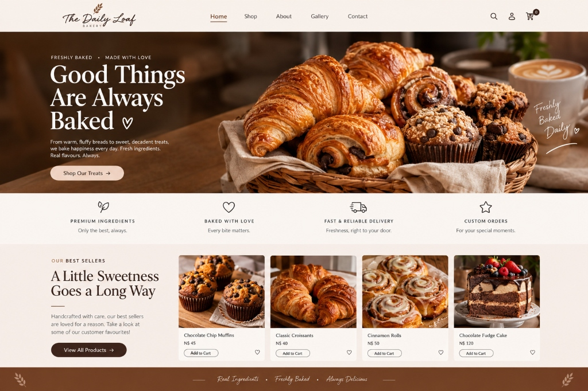

# 🥖 The Daily Loaf Bakery

> **“Good Things Are Always Baked ♡”**  
> A complete, modern, artisan bakery website inspired by boutique European-style micro-bakeries in Windhoek, Namibia.



---

## 🎨 Brand Identity & Aesthetic

- **Warm Cream**: `#FFF5ED`
- **Chocolate Brown**: `#4A281B`
- **Caramel Accent**: `#B87950`
- **Soft Blush**: `#EAD4C5`
- **Typography**: 
  - *Cormorant Garamond* (Artisan Serif headings)
  - *Plus Jakarta Sans* (Clean modern sans-serif body & UI)
  - *Alex Brush* (Calligraphic script for accents and bakery brand)

---

## ✨ Features

- **🥐 Exact Reference Design Hero**: Split hero section with dark chocolate brown background, handcrafted pastry basket photography, and floating cursive sticker: *"Freshly Baked Daily ♡"*.
- **⭐ Four Guarantees Bar**: Premium Ingredients, Baked With Love, Fast & Reliable Delivery, and Custom Orders.
- **🏷️ Best Sellers Grid**: Highlights customer favourites with prices in Namibian dollars (N$): Chocolate Chip Muffins (N$ 45), Classic Croissants (N$ 40), Cinnamon Rolls (N$ 50), Chocolate Fudge Cake (N$ 120).
- **🛒 Interactive Shopping Cart**: Slide-over drawer, quantity steppers, item deletion, live subtotal, and automatic delivery fee calculation (free delivery on orders over N$ 300).
- **💾 LocalStorage Persistence**: Cart and Wishlist items remain saved across page refreshes.
- **💬 Direct WhatsApp Ordering**: Generates formatted, itemized WhatsApp order messages complete with order reference `#DLB-XXXXX`, quantities, totals in N$, delivery address, and notes to the bakery counter (`+264 81 123 4567`).
- **🔍 Live Search & Sorting**: Real-time product search across all categories (Pastries, Cakes, Cupcakes, Bread, Cookies, Special Orders) and sorting by Price (Low/High), Rating, and Name.
- **🔎 Product Detail Modal**: High-res photography, ingredients list, allergen notices, dietary badges, quantity selector, and instant WhatsApp inquiry button.
- **❤️ Wishlist System**: Save favorite bakes with real-time counter badge and saved list drawer.
- **📖 About Us & Editorial**: The bakery story, 36-hour slow sourdough fermentation, 100% Namibian cultured butter, and head baker feature.
- **📸 Filterable Photo Gallery**: High-resolution gallery with full-screen lightbox preview.
- **📬 Validated Forms**: Interactive contact form and newsletter subscription with instant client-side validation and feedback.
- **📱 Fully Responsive**: Pixel-perfect layout for mobile (<640px), tablet (640px-1024px), and desktop.

---

## 🚀 Getting Started

### Option 1: Direct in Browser
Simply open `index.html` in any modern web browser (Edge, Chrome, Safari, Firefox). All dependencies and styling are self-contained.

### Option 2: PowerShell Web Server (Included)
Run the zero-dependency local development server:
```powershell
powershell -ExecutionPolicy Bypass -File server.ps1
```
The server will start at `http://localhost:3000/` and open your default browser.

### Option 3: Node / npx
```bash
npx serve .
# or
npm start
```

---

## 🛠️ Configuration & Customization

All bakery configuration, pricing, and contact details can be customized directly in [`js/data.js`](js/data.js):

- `currency`: Default `"N$"` (Namibian Dollar).
- `whatsappNumber`: Phone number used for WhatsApp click-to-chat (`"264811234567"`).
- `address`: Physical bakery address.
- `deliveryFee` & `freeDeliveryThreshold`: Configurable delivery pricing.
- `PRODUCTS`: Master catalog array of treats, descriptions, prices, and allergen details.

---

## 📄 License
ISC License © 2026 The Daily Loaf Bakery.
